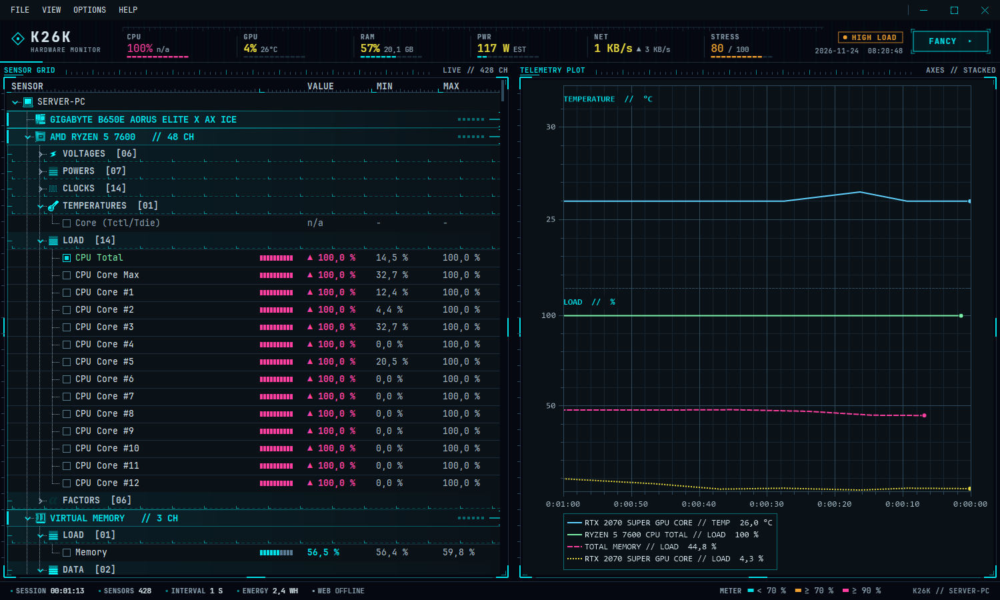
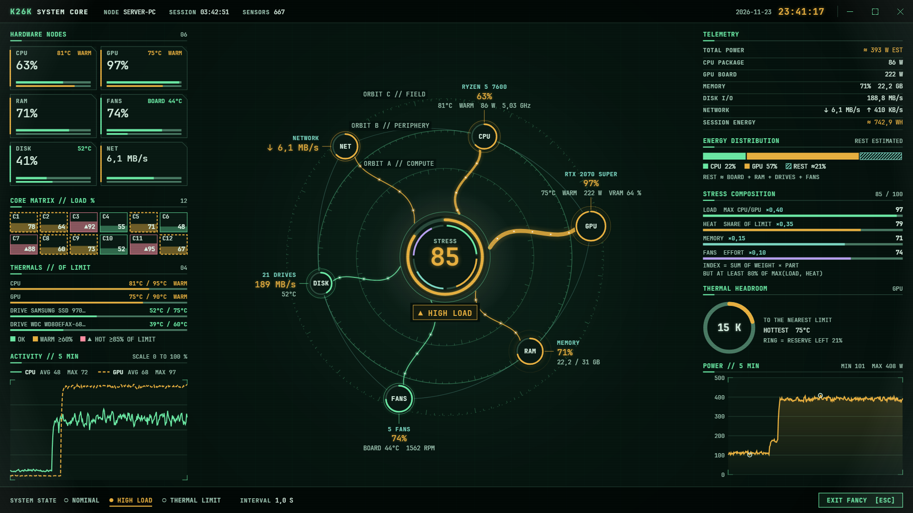
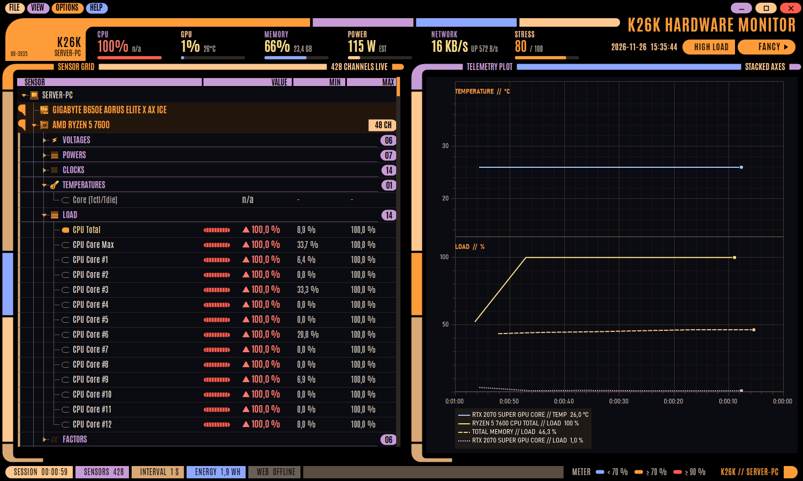
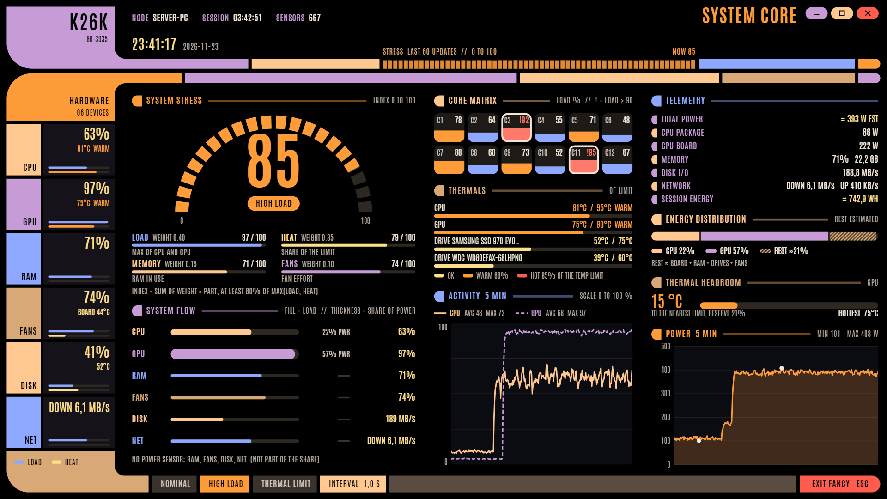
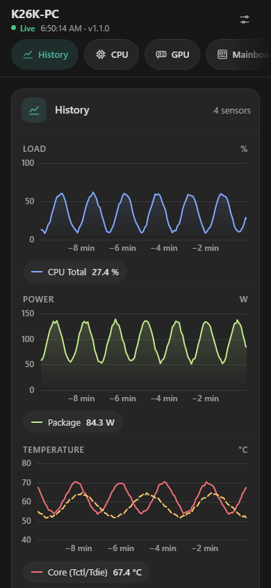
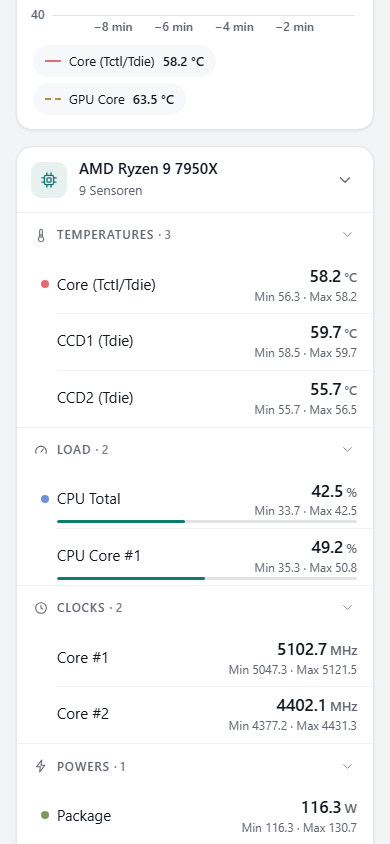
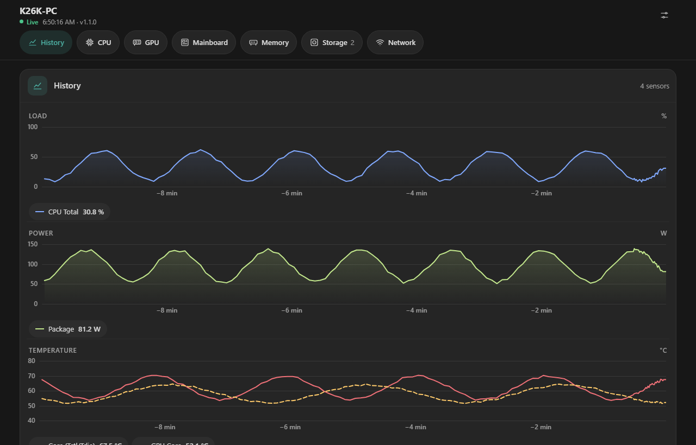

# K26K Hardware Monitor

K26K Hardware Monitor is an extended version of [LibreHardwareMonitor](https://github.com/LibreHardwareMonitor/LibreHardwareMonitor).
It adds a **new web interface optimized for smartphones**: all sensors and charts can be viewed in the browser
of a phone, tablet or another PC, with the same settings you configured in the desktop app.
The desktop app itself comes with new designs: **Sci-Fi** and **Bridge**, each with an animated **Fancy** dashboard.

## What's new?

- **Desktop designs** under **View → Design** (the choice is remembered):
  - **Sci-Fi** (default): HUD header with live values and system state, status strip, framed sensor grid with
    device and group heads, segmented meters and colored values (orange from 70 %, pink with ▲ from 90 %),
    plot with legend, axis heads, line styles per curve and calm axis scaling. All functions of the classic
    window (rename, hide, plot, pen color, context menus, gadget, tray, web server) stay the same.
  - **Fancy Mode** (**F11**, the FANCY button or the menu; **Esc** returns): an animated dashboard inside the main
    window with computed metrics: system stress (0 to 100, with its composition and weights), thermal headroom,
    energy distribution (estimates marked as such), session energy, core matrix, activity and power history.
    New values glide in one after another instead of all changing in the same frame, and the charts scroll
    continuously; the update interval from the options stays as it is.
    Options: **Reduced Motion** (follows the Windows animation setting), **Glow Effects**, **Fancy Mode in Fullscreen**.
  - **Bridge**: a console look of flat color bars with rounded elbows, pill buttons and condensed lettering on
    black. Header with live values, state and FANCY pill, sensor grid and plot in elbow frames, a status strip of
    color blocks. All functions of the classic window stay the same, as in Sci-Fi.
  - **Bridge Fancy** (F11, the FANCY pill or the menu while Bridge is active; **Esc** returns): the Fancy dashboard
    with the same data and functions in the Bridge look: stress gauge with its four parts, a block per device,
    system flow (load as fill, share of the power as track thickness), core matrix, thermals, activity,
    telemetry, energy distribution, thermal headroom and power history. It uses less CPU than Fancy (no glow).
  - Sci-Fi, Bridge and both dashboards have no Windows title bar: minimize, maximize and close are drawn in the
    design (Sci-Fi and Bridge at the right of the menu row, the dashboards in their top strip). The menu row, the header and the top strip move the window
    (drag, double click to maximize, snap), the window edges resize it.
  - **Classic**: the familiar LibreHardwareMonitor look with the Light/Dark/Black/Auto themes. With Windows
    high contrast, the first start uses Classic.

  <p>
    
  </p>
  <p>
    
  </p>
  <p>
    
  </p>
  <p>
    
  </p>

  <sub>Sci-Fi and Bridge windows under full CPU load (real data), the dashboards with a sample load scenario.
  How the designs were reviewed is documented in [docs/desktop-design-council](docs/desktop-design-council/README.md)
  and, for Bridge, in [docs/desktop-design-council/bridge](docs/desktop-design-council/bridge/README.md).</sub>


- **History kept after a restart** (**Options → Keep History After Restart**, on by default): the recorded sensor values
  (up to 24 hours, see **Sensor Values Time Window**) survive closing the program and restarting Windows. They are
  saved on exit, at Windows shutdown and every 10 minutes into `K26KHardwareMonitor.history` next to the program; the
  last hour as recorded, older values as 30 second averages (a full day is a few MB). Switched off, the recording
  starts empty after each start and the file is deleted. The plot, the web interface and its charts show the restored
  history; the short Fancy and Sci-Fi charts start fresh.

- **Mobile web interface** at `http://<PC-IP>:<port>/` (default port 8085)
  - One card per hardware item with its key values in the header, sensor groups, large readable values and load bars
  - Quick-jump bar (CPU, GPU, storage, network …) for systems with many devices
  - **History card** with exactly the curves selected for the plot in the desktop app
  - Tap a sensor to open **its own chart**; tap or drag inside a chart to read the values at that moment
  - Chart time span from 1 min to 24 h, or the same as the desktop plot
  - Search/filter, expand/collapse, can be added to the home screen as an app
  - English and German interface, switchable in the view menu; English by default, the choice is remembered in the browser
  - Light and dark mode derived from the desktop theme, WCAG-oriented contrast, line styles in addition to colors

  <p>
    
    &nbsp;
    
  </p>
  <p>
    
  </p>

  <sub>Screenshots with sample data: phone in dark and light mode, desktop browser in dark mode.</sub>

- **Mirrored desktop settings** (live, no reload needed):
  - Theme (Light/Dark/Black/Auto) including the plot color palette
  - Hidden sensors and "Show Hidden Sensors"
  - Renamed sensors and hardware
  - Value/Min/Max columns
  - Plot on/off, selected plot sensors and their colors, "Stacked Axes", visible time span, line thickness
  - Temperature unit °C/°F
  - Expanded state of hardware and sensor groups
  - Update interval
- **New JSON API** (read-only):
  - `GET /api/state`: sensor tree, current values and mirrored settings
  - `GET /api/history?ids=<id1>,<id2>&span=<seconds>&points=<count>`: value history, reduced to `points` points
- The previous web page is still available as `classic.html`; `data.json`, `/Sensor` and `/metrics` work as before.

## Usage

1. Start K26K Hardware Monitor **as administrator** (like LibreHardwareMonitor).
2. Under **Options → Remote Web Server → Interface/Port**, select the PC's IP address in your local network (not `127.0.0.1`) and set the port.
3. Enable **Options → Remote Web Server → Run**.
4. Allow the port (default 8085, TCP) in the Windows firewall for private networks, e.g. in an administrator PowerShell:
   ```powershell
   New-NetFirewallRule -DisplayName "K26K Hardware Monitor" -Direction Inbound -Protocol TCP -LocalPort 8085 -Action Allow -Profile Private
   ```
5. Open `http://<PC-IP>:8085/` on your smartphone.

To take over all settings of an installed LibreHardwareMonitor, use the [Libre Settings Importer](Libre-Settings-Importer/README.md).

Optionally, set a user name and password under **Options → Remote Web Server → Authentication**.
Note: the connection is unencrypted HTTP and only meant for your own network.

## Building

Requires the .NET SDK version the project files target (currently .NET 11, see `.github/workflows`).

```powershell
dotnet build LibreHardwareMonitor.Windows.Forms\LibreHardwareMonitor.Windows.Forms.csproj -c Release -p:Platform=x64
```

The new web interface lives in `LibreHardwareMonitor.Windows.Forms/Resources/Web/` (`index.html`, `app.js`, `app.css`),
the API in `LibreHardwareMonitor.Windows.Forms/Utilities/WebApi.cs`.
How the design was reviewed and refined is documented in [docs/design-council](docs/design-council/README.md).
The desktop designs live in `UI/SciFi/`, `UI/Fancy/`, `UI/Bridge/` and `Telemetry/`; their review is documented in
[docs/desktop-design-council](docs/desktop-design-council/README.md).

## Pulling in updates from LibreHardwareMonitor

This repository is a fork. Changes from the original project can be merged like this:

```powershell
git fetch upstream
git merge upstream/master
```

## License

- K26K Hardware Monitor as a whole is distributed under the **GNU Affero General Public License v3.0**, see [LICENSE](LICENSE).
- The LibreHardwareMonitor code is licensed under the **Mozilla Public License 2.0**, see [LICENSE-MPL-2.0](LICENSE-MPL-2.0).
  The MPL notices in those files are kept; section 3.3 of the MPL 2.0 allows distributing them as part of a
  larger work under the (A)GPL.
- New K26K files (`WebApi.cs`, `Resources/Web/index.html`, `app.js`, `app.css`, `manifest.webmanifest`, `icon.svg`,
  the desktop designs in `UI/SciFi/`, `UI/Fancy/`, `UI/Bridge/`, `UI/Themes/SciFiTheme.cs`, `UI/Themes/BridgeTheme.cs`,
  `UI/MainForm.Design.cs`, `UI/MainForm.Bridge.cs` and `Telemetry/`)
  are licensed under AGPL-3.0-or-later.
- The desktop designs use [SkiaSharp](https://github.com/mono/SkiaSharp) (MIT) and the embedded fonts
  [JetBrains Mono](https://github.com/JetBrains/JetBrainsMono) and [Antonio](https://github.com/googlefonts/antonioFont)
  (both SIL Open Font License 1.1).
- The Bridge design is an original work: its layout, shapes, colors and texts were drawn for this project. It is
  not affiliated with or endorsed by any film or television production and uses none of their artwork, logos,
  names or fonts.
- Further third-party notices: [THIRD-PARTY-NOTICES.txt](THIRD-PARTY-NOTICES.txt).

The web interface links to the source code (AGPL section 13).

---

## Original LibreHardwareMonitor README
[](https://github.com/LibreHardwareMonitor/LibreHardwareMonitor/blob/master/LICENSE)

[](https://www.nuget.org/packages/LibreHardwareMonitorLib/)
[](https://www.nuget.org/packages/LibreHardwareMonitorLib/)
[](https://www.nuget.org/packages/LibreHardwareMonitorLib/)

Libre Hardware Monitor is free software that can monitor the temperature sensors, fan speeds, voltages, load and clock speeds of your computer. 

## What's included?
| Name| Build Status |
| --- | --- |
| **LibreHardwareMonitorLib** <br /> Library that allows you to use all features in your own application | [](https://github.com/LibreHardwareMonitor/LibreHardwareMonitor/actions) |
| **LibreHardwareMonitor.Windows.Forms** <br /> Windows Forms based application that presents all data in a graphical interface | [](https://github.com/LibreHardwareMonitor/LibreHardwareMonitor/actions) |
| **LibreHardwareMonitor.Avalonia** <br /> Avalonia based application that presents all data in a graphical interface <br/> _In development, not recommended yet_ | [](https://github.com/LibreHardwareMonitor/LibreHardwareMonitor/actions) |

## What can it do?
You can read information from devices such as:
- Motherboards
- Intel and AMD processors
- NVIDIA, AMD and Intel graphics cards
- HDD, SSD and NVMe hard drives
- Network cards

## Where can I download it?
You can download the latest release [here](https://github.com/LibreHardwareMonitor/LibreHardwareMonitor/releases).

### Nightly builds
If you have a **GitHub** account, you can download nightly builds [here](https://github.com/LibreHardwareMonitor/LibreHardwareMonitor/actions).

Otherwise, you can download the *latest* nightly build
[here (Windows.Forms)](https://nightly.link/LibreHardwareMonitor/LibreHardwareMonitor/workflows/master/master/LibreHardwareMonitor.Windows.Forms.zip)
or [here (Avalonia)](https://nightly.link/LibreHardwareMonitor/LibreHardwareMonitor/workflows/master/master/LibreHardwareMonitor.Avalonia%20%28win-x64%29.zip).

## How can I help improve it?
The LibreHardwareMonitor team welcomes feedback and contributions!<br/>
You can check if it works properly on your motherboard. For many manufacturers, the way of reading data differs a bit, so if you notice any inaccuracies, please send us a pull request. If you have any suggestions or improvements, don't hesitate to create an issue.

### Which .NET versions are supported?

| Target | Library | Windows.Forms | Avalonia |
| --- | --- | --- | --- |
| .NET Framework 4.7.2 | ✅ | ✅ | ❌ |
| .NET Framework 4.8.1 | ✅ | ✅ | ❌ |
| .NET Standard 2.0 | ✅ | ✅ | ❌ |
| .NET 10 | ✅ | ✅ | ✅ |
| .NET 11 | ✅ | ❌ | ❌ |

## Developer information
**Integrate the library in own application**
1. Add the [LibreHardwareMonitorLib](https://www.nuget.org/packages/LibreHardwareMonitorLib/) NuGet package to your application.
2. Use the sample code below.

**Sample code**
```c#
Computer computer = new Computer
{
    IsCpuEnabled = true,
    IsGpuEnabled = true,
    IsMemoryEnabled = true,
    IsMotherboardEnabled = true,
    IsControllerEnabled = true,
    IsNetworkEnabled = true,
    IsStorageEnabled = true,
    IsPowerMonitorEnabled = true,
};

computer.Open();
computer.Accept(new UpdateVisitor());

foreach (IHardware hardware in computer.Hardware)
{
    Console.WriteLine("Hardware: {0}", hardware.Name);
    
    foreach (IHardware subhardware in hardware.SubHardware)
    {
        Console.WriteLine("\tSubhardware: {0}", subhardware.Name);
        
        foreach (ISensor sensor in subhardware.Sensors)
            Console.WriteLine("\t\tSensor: {0}, value: {1}", sensor.Name, sensor.Value);
    }

    foreach (ISensor sensor in hardware.Sensors)
        Console.WriteLine("\tSensor: {0}, value: {1}", sensor.Name, sensor.Value);
}

computer.Close();

public class UpdateVisitor : IVisitor
{
    public void VisitComputer(IComputer computer) => computer.Traverse(this);

    public void VisitHardware(IHardware hardware)
    {
        hardware.Update();
        foreach (IHardware subHardware in hardware.SubHardware)
            subHardware.Accept(this);
    }

    public void VisitSensor(ISensor sensor) { }

    public void VisitParameter(IParameter parameter) { }
}
```

**Administrator rights**

Some sensors require administrator privileges to access the data. Restart your IDE with admin privileges, or add an [app.manifest](https://learn.microsoft.com/en-us/windows/win32/sbscs/application-manifests) file to your project with requestedExecutionLevel on requireAdministrator.

## Warning

We're **not affiliated** with `librehardwaremonitor.com`.<br>
For your safety, please avoid using that site.

## Acknowledgements

Many thanks to all contributors listed below, and to JetBrains for providing tooling.

<a href="https://github.com/LibreHardwareMonitor/LibreHardwareMonitor/graphs/contributors">
  
</a>

## License
LibreHardwareMonitor is free and open source software licensed under MPL 2.0. Some parts of LibreHardwareMonitor are licensed under different terms, see [THIRD-PARTY-LICENSES](https://github.com/LibreHardwareMonitor/LibreHardwareMonitor/blob/master/THIRD-PARTY-NOTICES.txt).
